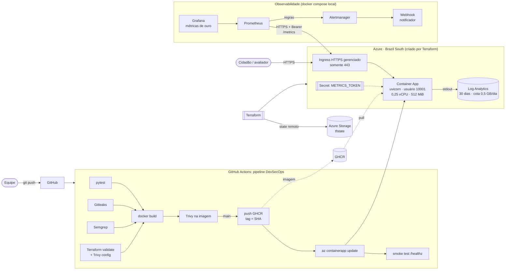

# SeguWatts · Deploy Blindado

Vitrine pública do MVP **SeguWatts**, publicada por um pipeline DevSecOps de ponta a ponta. Componente **Produção** da Global Solution 2026.2 (FIAP, Engenharia de Software, 4º ano), disciplina **Secure DevOps Tools & Cloud Computing**.

A aplicação apresenta os seis componentes do produto, cada um construído em uma disciplina, e mostra em tempo real qual versão está no ar.

| | |
|---|---|
| **URL pública** | `https://<preencher após o terraform apply>` |
| **Repositório** | https://github.com/dejesuscaua/Global-Solution |
| **Painel de observabilidade** | Grafana local apontando para a URL pública (ver [Observabilidade](#observabilidade)) |

## Ficha técnica do MVP

| Item | Descrição |
|---|---|
| **Nome do produto** | SeguWatts (“segura os watts”), assistente de uso consciente de energia residencial |
| **Cidadão e território** | Famílias de renda baixa e média no estado de São Paulo |
| **Problema, em uma frase** | O morador só descobre que gastou demais quando a conta chega, e mesmo assim não sabe por quê |
| **Proposta de valor** | Mostrar quando e onde a casa gasta, quanto custa e avisar cedo sobre aparelho com defeito, dizendo em reais quanto dá para economizar |
| **Arquitetura: componentes** | EcoBot (físico) → SeguWatts Vision (visão) → Pipeline Airflow/Databricks (dados) → Energia Clara (GenAI) → Alertas n8n (RPA), publicados por esta esteira DevSecOps (produção) |
| **Fontes de dados** | Open-Meteo, ANEEL (tarifas e bandeiras), IBGE e dados simulados documentados de sensores, contas e cadastro |
| **Modelos de IA utilizados** | k-NN embarcado no ESP32, SmolLM2 com RAG e LoRA, agente OpenAI no n8n, YOLO na visão computacional |
| **URL do MVP e repositório** | Ver tabela acima |
| **Indicadores de impacto** | Casas com defeito detectado, R$ e kWh economizados por casa e % de redução no consumo. Na simulação: 30 de 100 casas, R$ 621/mês no total, R$ 20,73 por casa, −10,5% de consumo |
| **ODS conectados** | 10 (redução das desigualdades), 11 (cidades sustentáveis), 13 (ação climática) |

## O problema e o impacto

A conta de luz mostra só o total do mês. Não diz em que horário, em que dia nem em qual aparelho a energia foi usada. Uma geladeira com a borracha da porta gasta, ou um aparelho esquecido ligado, pode aumentar a conta por meses sem ninguém perceber. Para famílias de renda baixa e média, esse desperdício invisível pesa no orçamento.

**Como funciona.** Um sensor geral no quadro de energia e sensores de tomada nos aparelhos que mais gastam e mais dão defeito (geladeira, freezer, ar-condicionado) medem o consumo a cada hora. O morador informa a conta de luz e os aparelhos que tem. O sistema cruza tudo com dados públicos reais (clima do Open-Meteo, tarifas e bandeiras da ANEEL, municípios do IBGE) e entrega:

- os dias e horários em que a casa mais gasta;
- o custo de cada mês, já com a tarifa da distribuidora e a bandeira tarifária;
- quanto cada aparelho pesa na conta;
- um alerta quando um aparelho passa a gastar mais do que o normal dele mesmo, sugerindo uma verificação e mostrando quanto o morador economizaria resolvendo.

**Resultado na simulação (100 residências):**

| Indicador | Valor |
|---|---|
| Casas com aparelho gastando acima do normal | 30 de 100 |
| Economia mensal somando essas casas | ≈ R$ 621 |
| Economia média por casa | R$ 20,73 por mês |
| Redução no consumo dessas famílias | 10,5% |

Sensores, contas e cadastro são simulados, com defeitos injetados e registrados para medir a detecção. Clima, tarifas e bandeiras são dados públicos reais.

### Repositórios dos componentes

| Componente | Disciplina | Repositório |
|---|---|---|
| Físico: EcoBot | Project-Based Maker Lab | https://github.com/ruiasiqueira/carrinho |
| Visão: SeguWatts Vision | Applied Computer Vision | https://github.com/dejesuscaua/Gs-visaocomputacional |
| Dados: Pipeline SeguWatts | Big Data Architecture & Data Integration | https://github.com/luanmacea/seguwatts-bigdata |
| Inteligência: Energia Clara | Generative AI for Engineering | https://github.com/daviguerra05/Global-Solution-AI |
| Automação: Alertas SeguWatts | Robotic Process Automation | https://github.com/luigiferrarasinno/SeguWatts |
| Produção: Deploy Blindado | Secure DevOps Tools & Cloud Computing | este repositório |

## Integrantes

| Nome | RM |
|---|---|
| Cauã Gonçalves de Jesus | RM97648 |
| Davi Passanha de Sousa Guerra | RM551605 |
| Luan Silveira Macea | RM98290 |
| Luigi Ferrara Sinno | RM98047 |
| Rui Amorim Siqueira | RM98436 |

---

## Arquitetura



| Peça | Escolha | Por quê |
|---|---|---|
| Aplicação | FastAPI + Jinja2, renderizada no servidor | Funciona sem JavaScript e em celular de entrada; sem banco nem formulário, logo sem dado pessoal |
| Container | `python:3.13-slim` multi-stage, usuário `10001`, sem `pip` | Imagem de ~200 MB, superfície de ataque mínima, nada além do necessário (`.dockerignore` em modo lista branca) |
| Nuvem | Azure Container Apps (consumo) | HTTPS gerenciado, sem VM, sem SSH, sem porta de administração; cabe no crédito do Azure for Students |
| IaC | Terraform `azurerm ~> 4.40`, state remoto em Azure Storage | Infra reproduzível; state e `.tfvars` nunca entram no Git |
| CI/CD | GitHub Actions com actions fixadas por SHA | Toda alteração passa pelas mesmas barreiras; deploy só da `main` |
| Registro | GHCR (`ghcr.io/dejesuscaua/global-solution`) | Gratuito para repositório público, autenticado pelo `GITHUB_TOKEN` efêmero |
| Observabilidade | Prometheus, Grafana e Alertmanager | Coletam `/metrics` do MVP publicado, protegido por token Bearer |

### Rotas da aplicação

| Rota | Função |
|---|---|
| `/` | Página de apresentação |
| `/api/projetos`, `/api/projetos/{slug}` | Conteúdo em JSON |
| `/api/status` | Versão (SHA do commit), ambiente e tempo no ar |
| `/healthz` | Verificação de vida (Docker, Azure e smoke test do pipeline) |
| `/metrics` | Métricas Prometheus. Exige `Authorization: Bearer <METRICS_TOKEN>` quando a variável existe |
| `/api/demo/falha` | Responde 500 de propósito, só com `DEMO_FALHAS=true`, para demonstrar o alerta |

Toda resposta sai com `Content-Security-Policy` restritiva (`default-src 'self'`, sem script inline), `Strict-Transport-Security`, `X-Frame-Options: DENY`, `X-Content-Type-Options: nosniff`, `Referrer-Policy` e `Permissions-Policy`. As fontes são servidas pelo próprio app, sem CDN, sem cookie e sem rastreador.

---

## Como reproduzir

### 1. Rodar tudo localmente (app + observabilidade)

Requisitos: Docker com Compose v2.

```bash
git clone https://github.com/dejesuscaua/Global-Solution.git
cd Global-Solution
cp .env.example .env            # defina GRAFANA_ADMIN_PASSWORD
docker compose up -d --build
```

| Serviço | Endereço |
|---|---|
| Vitrine | http://127.0.0.1:8000 |
| Grafana (painel "SeguWatts · Métricas de ouro") | http://127.0.0.1:3000, usuário `admin` |
| Prometheus (alvos e alertas) | http://127.0.0.1:9090/alerts |
| Alertmanager | http://127.0.0.1:9093 |

Todas as portas escutam só em `127.0.0.1`. O container da aplicação roda com `read_only`, `cap_drop: ALL`, `no-new-privileges` e os mesmos limites de CPU e memória da nuvem.

### 2. Testes

```bash
python -m venv .venv && . .venv/bin/activate
pip install -r requirements-dev.txt
pytest -q
```

### 3. Criar a nuvem com Terraform

Requisitos: [Azure CLI](https://learn.microsoft.com/cli/azure/install-azure-cli), Terraform ≥ 1.6 e uma assinatura Azure (Azure for Students serve).

```bash
az login
export ARM_SUBSCRIPTION_ID=$(az account show --query id -o tsv)

# 3.1 Storage para o state remoto (uma única vez)
az group create -n rg-seguwatts-tfstate -l brazilsouth
az storage account create -n stseguwattstfstate -g rg-seguwatts-tfstate -l brazilsouth \
  --sku Standard_LRS --min-tls-version TLS1_2 --allow-blob-public-access false
az storage container create -n tfstate --account-name stseguwattstfstate --auth-mode login
az role assignment create --assignee $(az ad signed-in-user show --query id -o tsv) \
  --role "Storage Blob Data Contributor" \
  --scope $(az storage account show -n stseguwattstfstate -g rg-seguwatts-tfstate --query id -o tsv)

# 3.2 Infra da aplicação
cd infra
cp backend.hcl.example backend.hcl
cp terraform.tfvars.example terraform.tfvars
export TF_VAR_metrics_token=$(openssl rand -hex 24)   # guarde: vai para o Prometheus
terraform init -backend-config=backend.hcl
terraform plan -out plano.tfplan
terraform apply plano.tfplan
terraform output url_publica
```

> O nome da storage account é global no Azure. Se `stseguwattstfstate` já existir, troque o nome no comando e no `backend.hcl`.

A imagem `ghcr.io/dejesuscaua/global-solution:latest` precisa existir antes do primeiro `apply`. Para isso, faça um push na `main` (o pipeline publica a imagem) e torne o pacote público em **GitHub → Packages → global-solution → Package settings → Change visibility → Public**.

### 4. Ligar o deploy automático

1. Crie uma identidade para o pipeline, com permissão **só** no resource group da aplicação:

   ```bash
   az ad sp create-for-rbac --name sp-seguwatts-deploy --role Contributor \
     --scopes $(az group show -n rg-seguwatts --query id -o tsv) --json-auth
   ```

2. Em **GitHub → Settings → Secrets and variables → Actions**:

   | Tipo | Nome | Valor |
   |---|---|---|
   | Secret | `AZURE_CREDENTIALS` | JSON completo do comando acima |
   | Secret | `AZURE_RESOURCE_GROUP` | `terraform output -raw resource_group` |
   | Secret | `AZURE_CONTAINERAPP_NAME` | `terraform output -raw container_app` |
   | Variable | `DEPLOY_HABILITADO` | `true` |

3. A partir daí, cada push na `main` que passar por todas as barreiras é publicado sozinho. O job só termina com sucesso quando o `/healthz` público responde com o SHA do novo commit.

---

## Pipeline DevSecOps

Arquivo: [`.github/workflows/devsecops.yml`](.github/workflows/devsecops.yml). Roda a cada push, em qualquer branch, e em pull requests.

| Etapa | Ferramenta | Barra o push quando |
|---|---|---|
| Testes | pytest | rota quebrada, cabeçalho de segurança ausente, `/metrics` aberto com token configurado |
| Segredos | Gitleaks | aparece chave, token ou senha em qualquer commit enviado |
| Código | Semgrep (`p/python`, `p/dockerfile`, `p/secrets`, `p/terraform`) | há padrão inseguro no código, no Dockerfile ou no Terraform |
| Infra | `terraform fmt` + `validate` + Trivy config | o Terraform é inválido ou tem configuração HIGH/CRITICAL |
| Imagem | Trivy | a imagem tem vulnerabilidade HIGH/CRITICAL com correção disponível |
| Deploy | Azure CLI + smoke test | a nova revisão não responde no `/healthz` com o SHA esperado |

Segredos ficam só em **GitHub Secrets** e no **secret do Container App**. O GHCR usa o `GITHUB_TOKEN` efêmero do próprio job. As actions de terceiros são fixadas por SHA de commit, e o workflow roda com `permissions: contents: read` (só o job de build ganha `packages: write`).

O roteiro para gerar a evidência de **uma execução barrada e a corrigida** está em [docs/EVIDENCIAS.md](docs/EVIDENCIAS.md).

---

## Observabilidade

A aplicação expõe as **quatro métricas de ouro** em `/metrics`:

| Métrica de ouro | Série | Painel no Grafana |
|---|---|---|
| Latência | `seguwatts_http_request_duration_seconds` (histograma por rota) | p50, p95 e p99 |
| Tráfego | `seguwatts_http_requests_total` | requisições por segundo, por rota |
| Erros | `seguwatts_http_requests_total{status=~"5.."}` | % de respostas 5xx (e 4xx) |
| Saturação | `seguwatts_http_requests_in_progress`, `process_cpu_seconds_total`, `process_resident_memory_bytes` | CPU e memória em relação ao limite do container |

A rota entra na métrica pelo **molde** (`/api/projetos/{slug}`), não pelo caminho digitado. Assim, quem varre URLs aleatórias não explode a cardinalidade do Prometheus.

### Alertas ([`observability/prometheus/alertas.yml`](observability/prometheus/alertas.yml))

| Alerta | Condição |
|---|---|
| `SeguWattsFora` | `/metrics` sem resposta por 1 min |
| `TaxaDeErrosAlta` | mais de 5% de respostas 5xx por 1 min |
| `LatenciaAlta` | p95 acima de 500 ms por 5 min |
| `SaturacaoAlta` | mais de 20 requisições simultâneas por 2 min |

O Alertmanager envia o alerta por webhook ao serviço `notificador`, que registra o que recebeu. Para receber no Discord, Slack ou Teams, troque a URL em `observability/alertmanager/alertmanager.yml`.

### Apontar o Prometheus local para o MVP publicado

```bash
cp observability/prometheus/targets/producao.json.example observability/prometheus/targets/producao.json
# edite o host com o valor de: terraform -chdir=infra output -raw fqdn
echo -n "$TF_VAR_metrics_token" > observability/prometheus/metrics_token
echo "METRICS_TOKEN_FILE=./observability/prometheus/metrics_token" >> .env
docker compose up -d
```

Os dois arquivos estão no `.gitignore`. No Grafana, o seletor **Ambiente** alterna entre `seguwatts-local` e `seguwatts-producao`.

### Disparar um alerta de propósito

```bash
./scripts/gerar_trafego.sh --com-falhas        # cerca de 30% de respostas 500 por 5 min
docker compose logs -f notificador             # o webhook do alerta aparece aqui
```

Em produção, o mesmo vale com `demo_falhas = true` no Terraform e `URL=https://<seu-app> ./scripts/gerar_trafego.sh --com-falhas`. O `SeguWattsFora` também pode ser disparado com `docker compose stop app`.

---

## Modelo de responsabilidade compartilhada

| Camada | Microsoft Azure | Equipe SeguWatts |
|---|---|---|
| Datacenter, rede física, hardware | ✔ | |
| Hipervisor, sistema do nó, Kubernetes por trás do Container Apps | ✔ | |
| Ingress, certificado TLS e balanceamento | ✔ (opera) | ✔ (exige HTTPS: `allow_insecure_connections = false`) |
| Imagem do container: base, bibliotecas, CVEs | | ✔ (Trivy, `apt-get upgrade`, dependências fixadas) |
| Código da aplicação e cabeçalhos de segurança | | ✔ (Semgrep, testes, CSP) |
| Segredos e credenciais | ✔ (cofre de secrets do Container App) | ✔ (Gitleaks, GitHub Secrets, nada no repositório) |
| Identidade e permissões | ✔ (Entra ID / RBAC) | ✔ (service principal limitado ao resource group) |
| Configuração da infraestrutura | | ✔ (Terraform revisado, Trivy config) |
| Dados e LGPD | | ✔ (minimização, retenção, região) |
| Monitoramento e resposta a incidente | ✔ (logs da plataforma) | ✔ (métricas de ouro, alertas) |

## LGPD: onde ficam os dados pessoais

| Onde | O que existe | Tratamento |
|---|---|---|
| Esta vitrine | Nenhum dado pessoal coletado: sem formulário, sem cookie, sem banco, sem analytics | Só nome e RM da equipe, publicados com o consentimento dos integrantes |
| Logs do Container Apps (Log Analytics, Brazil South) | IP de quem acessa e linha da requisição | Retenção de 30 dias, acesso restrito ao resource group, dados no Brasil |
| Métricas (Prometheus) | Só contadores agregados por rota e status | Nenhum IP, usuário ou URL livre (rota pelo molde) |
| Pipeline de dados (Databricks) | Cadastro e consumo **simulados** | Camada Ouro sem nome, CPF, e-mail ou telefone; titular e residência em SHA-256 com sal fora do código |
| Automação (n8n + Google Sheets) | Consumo por aparelho e e-mail do morador | Planilha privada; o agente de IA recebe só os aparelhos críticos, não o cadastro |
| Energia Clara e EcoBot | Processamento local | Nada sai do computador ou do ESP32 |
| SeguWatts Vision | Imagens da câmera | Processadas no dispositivo; só o evento (cômodo, aparelho, horário) é enviado |

## Estimativa de custo mensal

Premissas: 1 réplica sempre ligada (0,25 vCPU e 0,5 GiB), tráfego de avaliação (menos de 100 mil requisições por mês) e preços públicos de consumo do Azure Container Apps em novembro de 2026. Confira na [calculadora do Azure](https://azure.microsoft.com/pricing/calculator/), porque os preços mudam.

| Item | Cálculo | US$/mês |
|---|---|---|
| Container Apps: vCPU | 0,25 × 2.592.000 s = 648.000 vCPU·s − 180.000 gratuitos = 468.000 × US$ 0,000003 (ocioso) | ~1,40 |
| Container Apps: memória | 0,5 × 2.592.000 s = 1.296.000 GiB·s − 360.000 gratuitos = 936.000 × US$ 0,000003 | ~2,81 |
| Container Apps: requisições | Menos de 2 milhões gratuitas | 0,00 |
| Log Analytics | Menos de 5 GB/mês gratuitos (cota de 0,5 GB/dia no Terraform) | 0,00 |
| Storage do tfstate | Alguns KB, Standard LRS | < 0,05 |
| GHCR e GitHub Actions | Gratuitos para repositório público | 0,00 |
| **Total estimado** | | **~US$ 4,30 (≈ R$ 25)** |

O valor cabe com folga no crédito de US$ 100 do Azure for Students. Com `min_replicas = 0`, o custo de computação ocioso cai para praticamente zero, mas a primeira visita depois de um tempo parado leva alguns segundos (cold start). Por isso mantivemos uma réplica durante a correção.

Para não pagar nada depois da avaliação: `terraform destroy` em `infra/` e `az group delete -n rg-seguwatts-tfstate`.

---

## Estrutura

```text
app/                    aplicação FastAPI (rotas, métricas, template, CSS, fontes)
  data/projetos.json    conteúdo de cada componente do MVP
tests/                  testes de rotas, cabeçalhos, métricas e token
Dockerfile              multi-stage, usuário não root, sem pip
docker-compose.yml      app + Prometheus + Alertmanager + Grafana + notificador
infra/                  Terraform (Azure Container Apps, Log Analytics)
observability/          configurações e painel provisionado do Grafana
scripts/gerar_trafego.sh  tráfego de demonstração e disparo de alerta
.github/workflows/      pipeline DevSecOps
docs/                   evidências e ideia de visão computacional
```

Fontes: Chakra Petch e Source Serif 4, ambas sob SIL Open Font License (licenças em `app/static/fonts/`).
