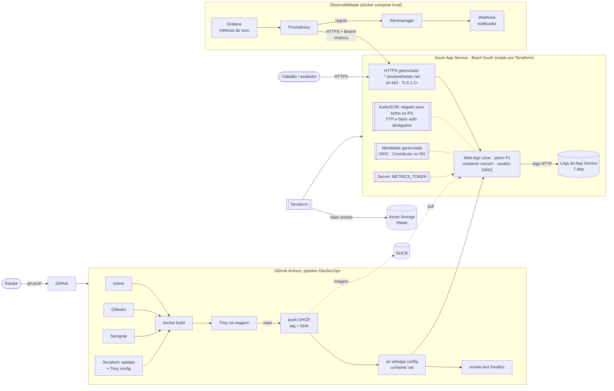

# SeguWatts · Deploy Blindado

Vitrine pública do MVP **SeguWatts**, publicada por um pipeline DevSecOps de ponta a ponta. Componente **Produção** da Global Solution 2026.2 (FIAP, Engenharia de Software, 4º ano), disciplina **Secure DevOps Tools & Cloud Computing**.

A aplicação apresenta os seis componentes do produto, cada um construído em uma disciplina, e mostra em tempo real qual versão está no ar.

| | |
|---|---|
| **URL pública** | `https://<preencher após o terraform apply>` |
| **Repositório** | https://github.com/dejesuscaua/Global-Solution |
| **Painel de observabilidade** | Grafana local apontando para a URL pública (ver [Observabilidade](#observabilidade)) |

## Ficha técnica do MVP

| Item | Descrição |
|---|---|
| **Nome do produto** | SeguWatts (“segura os watts”), assistente de uso consciente de energia residencial |
| **Cidadão e território** | Famílias de renda baixa e média no estado de São Paulo |
| **Problema, em uma frase** | O morador só descobre que gastou demais quando a conta chega, e mesmo assim não sabe por quê |
| **Proposta de valor** | Mostrar quando e onde a casa gasta, quanto custa e avisar cedo sobre aparelho com defeito, dizendo em reais quanto dá para economizar |
| **Arquitetura: componentes** | EcoBot (físico) → SeguWatts Vision (visão) → Pipeline Airflow/Databricks (dados) → Energia Clara (GenAI) → Alertas n8n (RPA), publicados por esta esteira DevSecOps (produção) |
| **Fontes de dados** | Open-Meteo, ANEEL (tarifas e bandeiras), IBGE e dados simulados documentados de sensores, contas e cadastro |
| **Modelos de IA utilizados** | k-NN embarcado no ESP32, SmolLM2 com RAG e LoRA, agente OpenAI no n8n, YOLO na visão computacional |
| **URL do MVP e repositório** | Ver tabela acima |
| **Indicadores de impacto** | Casas com defeito detectado, R$ e kWh economizados por casa e % de redução no consumo. Na simulação: 30 de 100 casas, R$ 621/mês no total, R$ 20,73 por casa, −10,5% de consumo |
| **ODS conectados** | 10 (redução das desigualdades), 11 (cidades sustentáveis), 13 (ação climática) |

## O problema e o impacto

A conta de luz mostra só o total do mês. Não diz em que horário, em que dia nem em qual aparelho a energia foi usada. Uma geladeira com a borracha da porta gasta, ou um aparelho esquecido ligado, pode aumentar a conta por meses sem ninguém perceber. Para famílias de renda baixa e média, esse desperdício invisível pesa no orçamento.

**Como funciona.** Um sensor geral no quadro de energia e sensores de tomada nos aparelhos que mais gastam e mais dão defeito (geladeira, freezer, ar-condicionado) medem o consumo a cada hora. O morador informa a conta de luz e os aparelhos que tem. O sistema cruza tudo com dados públicos reais (clima do Open-Meteo, tarifas e bandeiras da ANEEL, municípios do IBGE) e entrega:

- os dias e horários em que a casa mais gasta;
- o custo de cada mês, já com a tarifa da distribuidora e a bandeira tarifária;
- quanto cada aparelho pesa na conta;
- um alerta quando um aparelho passa a gastar mais do que o normal dele mesmo, sugerindo uma verificação e mostrando quanto o morador economizaria resolvendo.

**Resultado na simulação (100 residências):**

| Indicador | Valor |
|---|---|
| Casas com aparelho gastando acima do normal | 30 de 100 |
| Economia mensal somando essas casas | ≈ R$ 621 |
| Economia média por casa | R$ 20,73 por mês |
| Redução no consumo dessas famílias | 10,5% |

Sensores, contas e cadastro são simulados, com defeitos injetados e registrados para medir a detecção. Clima, tarifas e bandeiras são dados públicos reais.

### Repositórios dos componentes

| Componente | Disciplina | Repositório |
|---|---|---|
| Físico: EcoBot | Project-Based Maker Lab | https://github.com/ruiasiqueira/carrinho |
| Visão: SeguWatts Vision | Applied Computer Vision | https://github.com/dejesuscaua/Gs-visaocomputacional |
| Dados: Pipeline SeguWatts | Big Data Architecture & Data Integration | https://github.com/luanmacea/seguwatts-bigdata |
| Inteligência: Energia Clara | Generative AI for Engineering | https://github.com/daviguerra05/Global-Solution-AI |
| Automação: Alertas SeguWatts | Robotic Process Automation | https://github.com/luigiferrarasinno/SeguWatts |
| Produção: Deploy Blindado | Secure DevOps Tools & Cloud Computing | este repositório |

## Integrantes

| Nome | RM |
|---|---|
| Cauã Gonçalves de Jesus | RM97648 |
| Davi Passanha de Sousa Guerra | RM551605 |
| Luan Silveira Macea | RM98290 |
| Luigi Ferrara Sinno | RM98047 |
| Rui Amorim Siqueira | RM98436 |

---

## Arquitetura



| Peça | Escolha | Por quê |
|---|---|---|
| Aplicação | FastAPI + Jinja2, renderizada no servidor | Funciona sem JavaScript e em celular de entrada; sem banco nem formulário, logo sem dado pessoal |
| Container | `python:3.13-slim` multi-stage, usuário `10001`, sem `pip` | Imagem de ~200 MB, superfície de ataque mínima, nada além do necessário (`.dockerignore` em modo lista branca) |
| Nuvem | Azure App Service Linux, plano **F1 (gratuito)** | HTTPS gerenciado, sem VM e sem SSH; painel Kudu/SCM negado para todos os IPs, FTP e publicação por senha desligados; custo zero |
| IaC | Terraform `azurerm ~> 4.40`, state remoto em Azure Storage | Infra reproduzível; state e `.tfvars` nunca entram no Git |
| CI/CD | GitHub Actions com actions fixadas por SHA | Toda alteração passa pelas mesmas barreiras; deploy só da `main` |
| Registro | GHCR (`ghcr.io/dejesuscaua/global-solution`) | Gratuito para repositório público, autenticado pelo `GITHUB_TOKEN` efêmero |
| Observabilidade | Prometheus, Grafana e Alertmanager | Coletam `/metrics` do MVP publicado, protegido por token Bearer |

### Rotas da aplicação

| Rota | Função |
|---|---|
| `/` | Página de apresentação |
| `/api/projetos`, `/api/projetos/{slug}` | Conteúdo em JSON |
| `/api/status` | Versão (SHA do commit), ambiente e tempo no ar |
| `/healthz` | Verificação de vida (Docker, Azure e smoke test do pipeline) |
| `/metrics` | Métricas Prometheus. Exige `Authorization: Bearer <METRICS_TOKEN>` quando a variável existe |
| `/api/demo/falha` | Responde 500 de propósito, só com `DEMO_FALHAS=true`, para demonstrar o alerta |

Toda resposta sai com `Content-Security-Policy` restritiva (`default-src 'self'`, sem script inline), `Strict-Transport-Security`, `X-Frame-Options: DENY`, `X-Content-Type-Options: nosniff`, `Referrer-Policy` e `Permissions-Policy`. As fontes são servidas pelo próprio app, sem CDN, sem cookie e sem rastreador.

---

## Como reproduzir

### 1. Rodar tudo localmente (app + observabilidade)

Requisitos: Docker com Compose v2.

```bash
git clone https://github.com/dejesuscaua/Global-Solution.git
cd Global-Solution
cp .env.example .env            # defina GRAFANA_ADMIN_PASSWORD
docker compose up -d --build
```

| Serviço | Endereço |
|---|---|
| Vitrine | http://127.0.0.1:8000 |
| Grafana (painel "SeguWatts · Métricas de ouro") | http://127.0.0.1:3000, usuário `admin` |
| Prometheus (alvos e alertas) | http://127.0.0.1:9090/alerts |
| Alertmanager | http://127.0.0.1:9093 |

Todas as portas escutam só em `127.0.0.1`. O container da aplicação roda com `read_only`, `cap_drop: ALL`, `no-new-privileges` e os mesmos limites de CPU e memória da nuvem.

### 2. Testes

```bash
python -m venv .venv && . .venv/bin/activate
pip install -r requirements-dev.txt
pytest -q
```

### 3. Criar a nuvem com Terraform (um comando)

Requisito: uma assinatura Azure (Azure for Students serve) em que você seja **Owner**, o padrão para quem ativou a conta de estudante.

O caminho mais curto é o **Azure Cloud Shell**, que já tem `az` e `terraform` instalados e já está logado:

1. Abra https://shell.azure.com e escolha **Bash**.
2. Rode:

   ```bash
   git clone https://github.com/dejesuscaua/Global-Solution.git
   cd Global-Solution
   ./scripts/azure_setup.sh
   ```

O script [`scripts/azure_setup.sh`](scripts/azure_setup.sh) é idempotente: se falhar no meio, corrija e rode de novo. Ele:

1. registra os provedores necessários (`Microsoft.App`, `Microsoft.OperationalInsights`, `Microsoft.ManagedIdentity`, `Microsoft.Storage`);
2. cria o Storage Account do **state remoto** (TLS 1.2, só HTTPS, sem acesso público);
3. gera `infra/backend.hcl`, `infra/terraform.tfvars` e o token de métricas em `infra/.metrics_token`, todos fora do git;
4. roda `terraform init`, `plan` e `apply`;
5. confere se a aplicação respondeu no `/healthz` e imprime os valores para configurar o GitHub.

> **Região bloqueada?** Algumas assinaturas de estudante só permitem certas regiões. Se aparecer `RequestDisallowedByAzure`, rode `LOCALIZACAO=eastus2 ./scripts/azure_setup.sh`.

No seu computador também funciona: instale a [Azure CLI](https://learn.microsoft.com/cli/azure/install-azure-cli) e o Terraform ≥ 1.6, rode `az login` e depois o script.

A imagem `ghcr.io/dejesuscaua/global-solution:latest` já é publicada pelo pipeline a cada push na `main`, e o pacote precisa estar público para o Azure baixá-la.

### 4. Ligar o deploy automático (sem senha, via OIDC)

O Terraform cria uma **identidade gerenciada** (`id-seguwatts-deploy`) com papel **Contributor apenas no resource group da aplicação**. Ela recebe uma *federated credential* que só aceita tokens do job que roda no environment `producao` deste repositório. O GitHub Actions troca o próprio token OIDC, de curta duração, por um acesso ao Azure. **Não existe client secret guardado em lugar nenhum.** Usamos identidade gerenciada, e não app registration, porque contas Azure for Students normalmente não podem criar aplicativos no Entra ID da faculdade.

Em **GitHub → Settings → Secrets and variables → Actions → Variables**, crie os valores que o script imprimiu:

| Variable | Valor |
|---|---|
| `AZURE_CLIENT_ID` | `terraform -chdir=infra output -raw azure_client_id` |
| `AZURE_TENANT_ID` | `terraform -chdir=infra output -raw azure_tenant_id` |
| `AZURE_SUBSCRIPTION_ID` | `terraform -chdir=infra output -raw azure_subscription_id` |
| `AZURE_RESOURCE_GROUP` | `terraform -chdir=infra output -raw resource_group` |
| `AZURE_WEBAPP_NAME` | `terraform -chdir=infra output -raw web_app` |
| `DEPLOY_HABILITADO` | `true` |

Nenhum desses valores é segredo: sozinhos, eles não dão acesso a nada. A partir daí, cada push na `main` que passar por todas as barreiras é publicado sozinho, e o job só termina com sucesso quando o `/healthz` público responde com o SHA do novo commit.

---

## Pipeline DevSecOps

Arquivo: [`.github/workflows/devsecops.yml`](.github/workflows/devsecops.yml). Roda a cada push, em qualquer branch, e em pull requests.

| Etapa | Ferramenta | Barra o push quando |
|---|---|---|
| Testes | pytest | rota quebrada, cabeçalho de segurança ausente, `/metrics` aberto com token configurado |
| Segredos | Gitleaks | aparece chave, token ou senha em qualquer commit enviado |
| Código | Semgrep (`p/python`, `p/dockerfile`, `p/secrets`, `p/terraform`) | há padrão inseguro no código, no Dockerfile ou no Terraform |
| Infra | `terraform fmt` + `validate` + Trivy config | o Terraform é inválido ou tem configuração HIGH/CRITICAL |
| Imagem | Trivy | a imagem tem vulnerabilidade HIGH/CRITICAL com correção disponível |
| Deploy | Azure CLI + smoke test | a nova revisão não responde no `/healthz` com o SHA esperado |

O deploy usa **OIDC**: o job troca um token de curta duração por acesso ao Azure, sem nenhuma senha guardada no GitHub. O único segredo da aplicação (`METRICS_TOKEN`) fica em uma **app setting do Web App** (criptografada em repouso), e o GHCR usa o `GITHUB_TOKEN` efêmero do próprio job. As actions de terceiros são fixadas por SHA de commit, e o workflow roda com `permissions: contents: read` (só o job de build ganha `packages: write`).

O roteiro para gerar a evidência de **uma execução barrada e a corrigida** está em [docs/EVIDENCIAS.md](docs/EVIDENCIAS.md).

---

## Observabilidade

A aplicação expõe as **quatro métricas de ouro** em `/metrics`:

| Métrica de ouro | Série | Painel no Grafana |
|---|---|---|
| Latência | `seguwatts_http_request_duration_seconds` (histograma por rota) | p50, p95 e p99 |
| Tráfego | `seguwatts_http_requests_total` | requisições por segundo, por rota |
| Erros | `seguwatts_http_requests_total{status=~"5.."}` | % de respostas 5xx (e 4xx) |
| Saturação | `seguwatts_http_requests_in_progress`, `process_cpu_seconds_total`, `process_resident_memory_bytes` | CPU e memória em relação ao limite do container |

A rota entra na métrica pelo **molde** (`/api/projetos/{slug}`), não pelo caminho digitado. Assim, quem varre URLs aleatórias não explode a cardinalidade do Prometheus.

### Alertas ([`observability/prometheus/alertas.yml`](observability/prometheus/alertas.yml))

| Alerta | Condição |
|---|---|
| `SeguWattsFora` | `/metrics` sem resposta por 1 min |
| `TaxaDeErrosAlta` | mais de 5% de respostas 5xx por 1 min |
| `LatenciaAlta` | p95 acima de 500 ms por 5 min |
| `SaturacaoAlta` | mais de 20 requisições simultâneas por 2 min |

O Alertmanager envia o alerta por webhook ao serviço `notificador`, que registra o que recebeu. Para receber no Discord, Slack ou Teams, troque a URL em `observability/alertmanager/alertmanager.yml`.

### Apontar o Prometheus local para o MVP publicado

```bash
cp observability/prometheus/targets/producao.json.example observability/prometheus/targets/producao.json
# edite o host com o valor de: terraform -chdir=infra output -raw fqdn
cp infra/.metrics_token observability/prometheus/metrics_token     # gerado pelo azure_setup.sh
echo "METRICS_TOKEN_FILE=./observability/prometheus/metrics_token" >> .env
docker compose up -d
```

Os dois arquivos estão no `.gitignore`. No Grafana, o seletor **Ambiente** alterna entre `seguwatts-local` e `seguwatts-producao`.

### Disparar um alerta de propósito

```bash
./scripts/gerar_trafego.sh --com-falhas        # cerca de 30% de respostas 500 por 5 min
docker compose logs -f notificador             # o webhook do alerta aparece aqui
```

Em produção, o mesmo vale com `demo_falhas = true` no Terraform e `URL=https://<seu-app> ./scripts/gerar_trafego.sh --com-falhas`. O `SeguWattsFora` também pode ser disparado com `docker compose stop app`.

---

## Modelo de responsabilidade compartilhada

| Camada | Microsoft Azure | Equipe SeguWatts |
|---|---|---|
| Datacenter, rede física, hardware | ✔ | |
| Hipervisor, sistema operacional e runtime de containers do App Service | ✔ | |
| Ingress, certificado TLS e balanceamento | ✔ (opera) | ✔ (exige HTTPS: `allow_insecure_connections = false`) |
| Imagem do container: base, bibliotecas, CVEs | | ✔ (Trivy, `apt-get upgrade`, dependências fixadas) |
| Código da aplicação e cabeçalhos de segurança | | ✔ (Semgrep, testes, CSP) |
| Segredos e credenciais | ✔ (app settings criptografadas, emissão de tokens OIDC) | ✔ (Gitleaks, deploy sem senha via OIDC, nada no repositório) |
| Identidade e permissões | ✔ (Entra ID / RBAC) | ✔ (identidade gerenciada do deploy, Contributor só no resource group) |
| Configuração da infraestrutura | | ✔ (Terraform revisado, Trivy config) |
| Dados e LGPD | | ✔ (minimização, retenção, região) |
| Monitoramento e resposta a incidente | ✔ (logs da plataforma) | ✔ (métricas de ouro, alertas) |

## LGPD: onde ficam os dados pessoais

| Onde | O que existe | Tratamento |
|---|---|---|
| Esta vitrine | Nenhum dado pessoal coletado: sem formulário, sem cookie, sem banco, sem analytics | Só nome e RM da equipe, publicados com o consentimento dos integrantes |
| Logs HTTP do App Service (Brazil South) | IP de quem acessa e linha da requisição | Retenção de 7 dias (limite de 35 MB), acesso restrito ao resource group, dados no Brasil |
| Métricas (Prometheus) | Só contadores agregados por rota e status | Nenhum IP, usuário ou URL livre (rota pelo molde) |
| Pipeline de dados (Databricks) | Cadastro e consumo **simulados** | Camada Ouro sem nome, CPF, e-mail ou telefone; titular e residência em SHA-256 com sal fora do código |
| Automação (n8n + Google Sheets) | Consumo por aparelho e e-mail do morador | Planilha privada; o agente de IA recebe só os aparelhos críticos, não o cadastro |
| Energia Clara e EcoBot | Processamento local | Nada sai do computador ou do ESP32 |
| SeguWatts Vision | Imagens da câmera | Processadas no dispositivo; só o evento (cômodo, aparelho, horário) é enviado |

## Estimativa de custo mensal

Premissas: plano F1 do App Service, tráfego de avaliação e preços públicos do Azure em novembro de 2026. Confira na [calculadora do Azure](https://azure.microsoft.com/pricing/calculator/), porque os preços mudam.

| Item | Detalhe | US$/mês |
|---|---|---|
| App Service plano F1 (Linux) | Gratuito: 1 GB de RAM, 60 min de CPU por dia, 1 GB de disco | 0,00 |
| Identidade gerenciada + federated credential | Sem custo | 0,00 |
| Logs HTTP do App Service | No sistema de arquivos do próprio app (7 dias, 35 MB) | 0,00 |
| Storage do tfstate | Alguns KB, Standard LRS | < 0,05 |
| GHCR e GitHub Actions | Gratuitos para repositório público | 0,00 |
| **Total estimado** | | **< US$ 0,05 (centavos de real)** |

**Trade-offs do F1:**
- O app dorme após ~20 min sem acesso (o F1 não permite *always on*), então a primeira visita depois disso leva uns 30 s.
- Há uma cota de 60 min de CPU por dia, folgada para uma vitrine; o Prometheus de produção coleta a cada 60 s para não gastar essa cota.

Para tráfego real, basta `SKU=B1 ./scripts/azure_setup.sh`: plano Basic, *always on* ligado, cerca de US$ 13/mês, coberto pelo crédito de US$ 100 do Azure for Students.

Para não pagar nada depois da avaliação: `terraform destroy` em `infra/` e `az group delete -n rg-seguwatts-tfstate`.

---

## Estrutura

```text
app/                    aplicação FastAPI (rotas, métricas, template, CSS, fontes)
  data/projetos.json    conteúdo de cada componente do MVP
tests/                  testes de rotas, cabeçalhos, métricas e token
Dockerfile              multi-stage, usuário não root, sem pip
docker-compose.yml      app + Prometheus + Alertmanager + Grafana + notificador
infra/                  Terraform (App Service F1, identidade OIDC do deploy)
observability/          configurações e painel provisionado do Grafana
scripts/gerar_trafego.sh  tráfego de demonstração e disparo de alerta
.github/workflows/      pipeline DevSecOps
docs/                   evidências e ideia de visão computacional
```

Fontes: Chakra Petch e Source Serif 4, ambas sob SIL Open Font License (licenças em `app/static/fonts/`).
